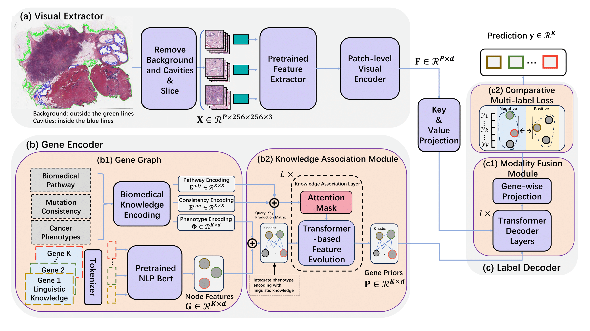
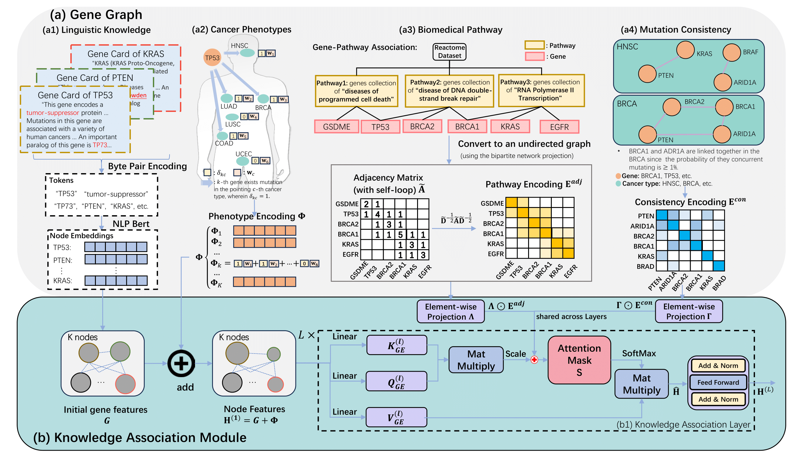

# BPGT: Knowledge-guided Multi-modality Transformer for Genetic Mutation Prediction

This repository contains the official implementation of **Biological-knowledge-enhanced PathGenomic multi-label Transformer (BPGT)** for multi-label genetic mutation prediction from whole slide images (WSIs).

BPGT combines WSI patch features with biological and linguistic gene knowledge. The main pipeline consists of:

- **Visual Extractor (VE)** for WSI patch feature aggregation.
- **Gene Encoder (GE)** for building biological gene priors from a Gene Graph (GG).
- **Knowledge Association Module (KAM)** for graph-based gene representation learning.
- **Label Decoder (LD)** for fusing visual features and gene priors.
- **Comparative multi-label loss** for mutation-profile discrimination.

Paper:
**Knowledge-guided multi-modality transformer for multi-label genetic mutation prediction**, Pattern Recognition, 2026.





## Installation

### 1. Create the conda environment

The original reproduction environment is defined in `environment.yaml`.

```bash
conda env create -f environment.yaml
conda activate dino
```

### 2. Install Python packages

```bash
pip install -r requirements.txt
```

The default BPGT + TransMIL setting uses `nystrom-attention`. WSI preprocessing also requires OpenSlide. If OpenSlide is not available on your system, install the system library first, for example:

```bash
sudo apt-get install openslide-tools
```

### 3. Verify the installation

```bash
python [3]_main.py --help
python exp_script.py --help
```

## Repository Structure

```text
BPGT/
|-- [0]_pipeline.py                 # End-to-end WSI preprocessing and feature extraction entry
|-- [0][0]_create_patches_fp.py     # WSI segmentation and patching
|-- [0][1]_create_step_2_csv.py     # Clean slide-level metadata
|-- [1]_create_step_3_csv.py        # Build mutation label table
|-- [2]_create_splits.py            # Create train/val/test splits
|-- [0][3]_extract_feature_hipt.py  # HIPT feature extraction
|-- [3]_main.py                     # Main training and evaluation entry
|-- exp_script.py                   # Experiment launcher
|-- experiments/base_model/         # Default BPGT configuration
|-- data/
|   |-- graph/                      # Gene graph adjacency files
|   |-- list/                       # Gene lists and linguistic embeddings
|   |-- pathways/                   # Reactome pathway resources
|   |-- data_loader.py              # Dataset loading utilities
|-- datasets/                       # PyTorch WSI dataset definitions
|-- model/
|   |-- model_exp.py                # BPGTModel wrapper and experiment variants
|   |-- BPGT.py                     # Gene Encoder and KAM implementation
|   |-- base_model.py               # Visual extractors, MIL backbones, decoders
|   |-- HIPT_4K/                    # HIPT feature extractor code
|   |-- ml_decoder.py               # Multi-label decoder utilities
|   |-- loss.py                     # Loss functions
|-- utils/
|   |-- core_utils.py               # Training loop
|   |-- graph_utils.py              # Biomedical graph encodings
|   |-- linguistic_encoding.py      # Linguistic gene embedding utilities
|   |-- model_selection.py          # Model/backbone selection
|   |-- pipeline/att_ml.py          # Multi-label training and evaluation
|-- wsi_core/                       # WSI patching and stitching utilities
|-- vis_utils/                      # Visualization utilities
```

## Data Preparation

### 1. Download WSIs

Download TCGA slides with the GDC client:

```bash
gdc-client download -m PATH_TO_GDC_MANIFEST -d PATH_TO_SAVE_TCGA_SLIDES
```

The preprocessing scripts expect region-organized slide folders. For TCGA, a typical layout is:

```text
data/tcga/
|-- BRCA/
|   |-- *.svs
|-- LUAD/
|   |-- *.svs
|-- ...
```

### 2. Generate patches, metadata, splits, and features

For one TCGA region, run:

```bash
python [0]_pipeline.py \
  --data tcga \
  --mag 20 \
  --ori_patch_size 256 \
  --r 0 \
  --model dino \
  --gpu 0
```

This pipeline calls the patching, CSV construction, split creation, and feature extraction scripts. The default DINO feature directory produced by the pipeline is used later by `[3]_main.py`.

If your patch features have already been extracted, make sure the experiment config points to the feature root via `data_root_dir` and `data_feature_dir`.

For HIPT features, place the HIPT checkpoints at the path passed to `--output_dir` so that the extractor can find:

```text
OUTPUT_DIR/
|-- vit256_small_dino.pth
|-- vit4k_xs_dino.pth
```

Then run the HIPT extractor through the pipeline with `--model hipt`, or directly with `[0][3]_extract_feature_hipt.py`.

## Running BPGT

### Train from the default configuration

The refactored default config is:

```text
experiments/base_model/exp_0/params.json
```

Run:

```bash
python [3]_main.py \
  --json_dir experiments/base_model \
  --exp_count 0 \
  --gpu 0
```

The default configuration uses:

- `graph_module=bpgt`
- `model=trans-ve`
- `word_embedd_model=biobert`
- `label_category=oncokb`
- `model_type=att_ml`

### Launch experiment variants

Use `exp_script.py` to generate and launch experiment variants:

```bash
python exp_script.py \
  --graph_module bpgt \
  --backbone trans-ve \
  --word_embedd_model biobert \
  --gpu_index 0
```

Backbones used in the paper's KAM ablation:

| Paper name | CLI value | Implementation |
| --- | --- | --- |
| GeneHe-VE | `genehe-ve` | DINO features with self-attention MIL |
| DeepHis-VE | `deephis-ve` | DINO features with dense/mean MIL |
| Att-VE | `att-ve` | DINO features with attention MIL |
| Trans-VE | `trans-ve` | DINO features with TransMIL |
| KAT | `kat` | DINO features with kernel attention and patch coordinates |
| HIPT | `hipt` | HIPT features with transformer aggregation |

Graph modules used in the paper's KAM ablation:

| Paper name | CLI value |
| --- | --- |
| w/o KAM | `mlp` |
| GCN | `gcn` |
| Graph Transformer | `graph_transformer` |
| MCAT | `mcat` |
| KAM (BPGT) | `bpgt` |

Common options:

- `--graph_module`: `bpgt`, `gcn`, `graph_transformer`, `mlp`, `mcat`
- `--backbone`: `genehe-ve`, `deephis-ve`, `att-ve`, `trans-ve`, `kat`, `hipt`
- `--word_embedd_model`: `biobert`, `clinical_bert`, `pubmed_bert`, `scibert`, `none`

To reproduce the paper-style KAM ablation grid across all visual extractor backbones and graph modules:

```bash
python exp_script.py --traverse --mode train --gpu_index 0
```

## Citation

If this code is useful for your research, please cite:

```bibtex
@article{huang2026knowledge,
  title={Knowledge-guided multi-modality transformer for multi-label genetic mutation prediction},
  author={Huang, Gexin and Wu, Chenfei and Li, Mingjie and Chang, Xiaojun and Sun, Ying and Xing, Lei and Liang, Xiaodan and Lin, Liang and Yang, Guang and Zhao, Shen},
  journal={Pattern Recognition},
  volume={175},
  pages={113047},
  year={2026},
  doi={10.1016/j.patcog.2026.113047},
  publisher={Elsevier}
}
```

## Acknowledgements

This implementation builds on common WSI multiple-instance learning pipelines and public pathology modeling components. Please also follow the licenses and data-use terms of TCGA, CPTAC, OpenSlide, and any pretrained feature extractors used in your experiments.
