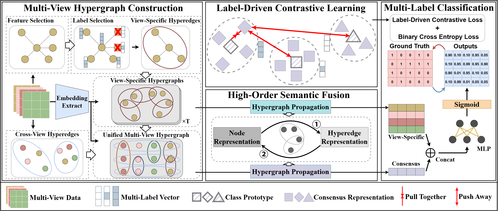
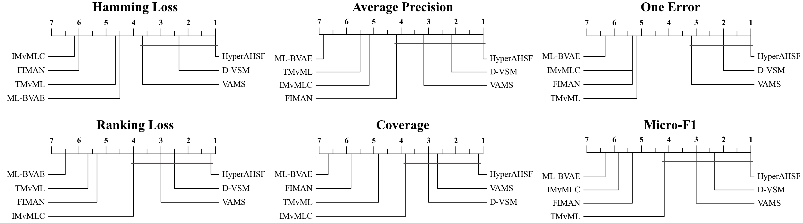
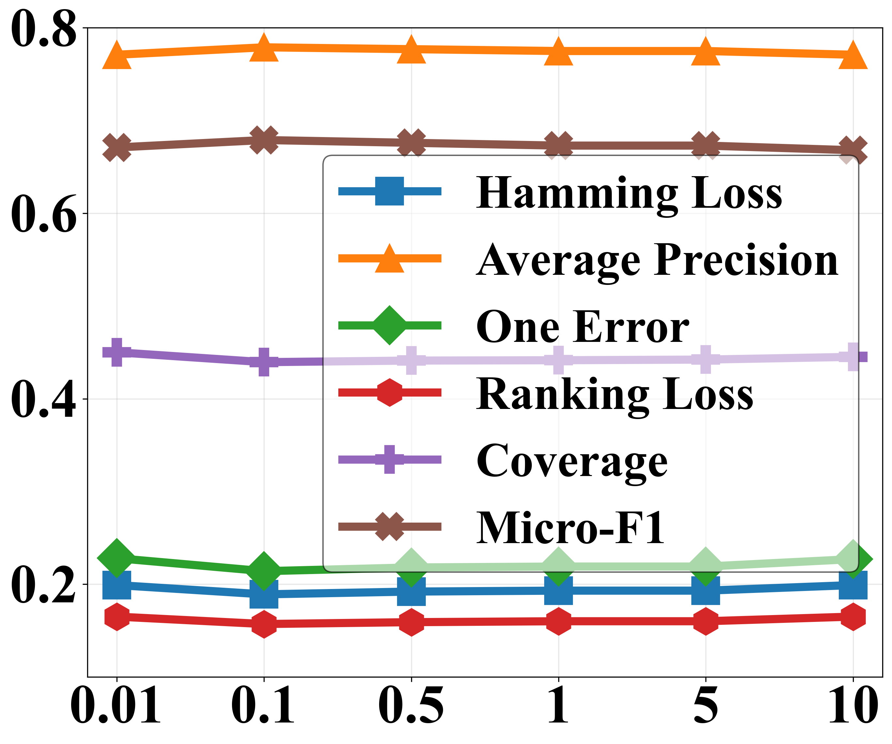
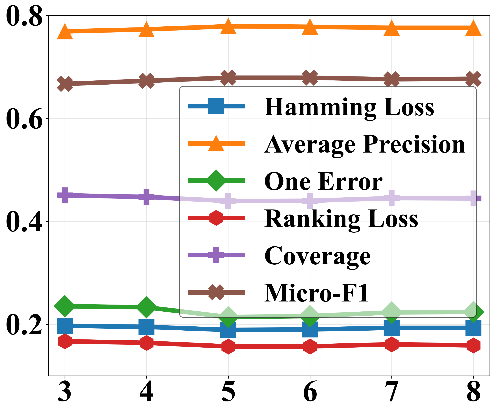
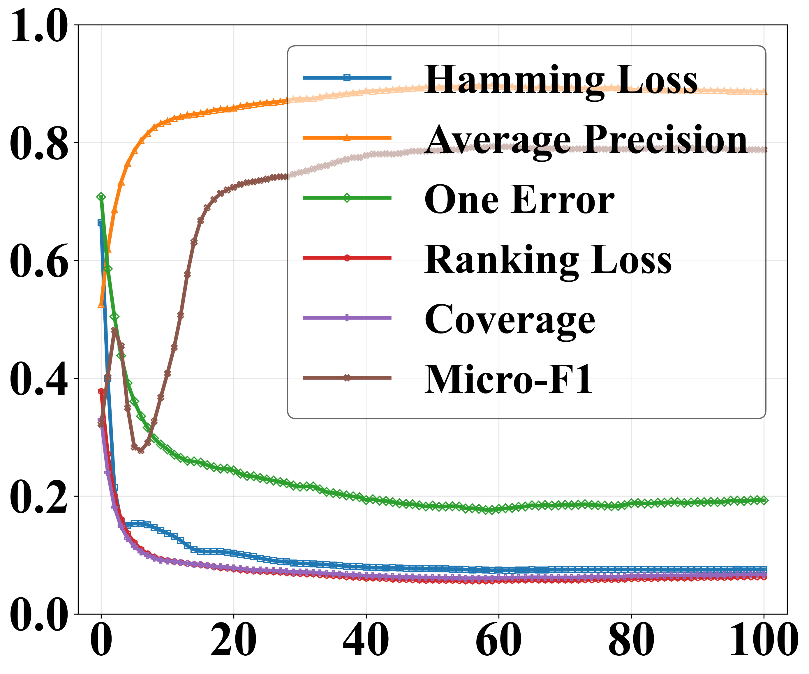
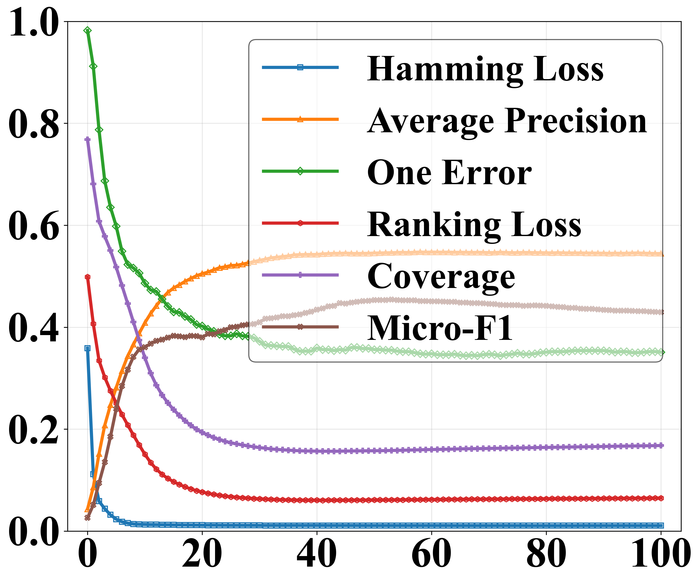

# 基于超图的多视图多标签分类：自适应高阶语义融合

**英文题名：** Hypergraph-Based Multi-View Multi-Label Classification via Adaptive High-Order Semantic Fusion  
**作者：** Yi Shan、Liyang Gao、Yuena Lin、Zhen Yang、Gengyu Lyu*、Honggui Han  
**单位：** 北京工业大学计算机学院  
**会议：** 第四十届 AAAI 人工智能会议（AAAI-26），2026，25269–25277 页。  
**作者邮箱：** yi.shan.bjut@gmail.com；oldgaoglycine@gmail.com；yuenalin@126.com；yangzhen@bjut.edu.cn；lyugengyu@gmail.com；rechardhan@bjut.edu.cn。  
\* 表示通信作者。

> 翻译说明：本文按文件夹中的原始 PDF 翻译，保留正文、公式编号、算法、图表及参考文献。图片保留原图，图题译为中文；参考文献保留英文书目信息，便于检索。文中实验结论均为原论文作者的陈述。

## 摘要

在多视图多标签（Multi-View Multi-Label，MVML）分类中，每个样本由多个异构视图表示，并标注有多个标签。现有方法通常利用成对语义关系挖掘视图内相关性，并对齐视图间特征，以生成结构化表示。然而，这些方法忽略了从群组角度直接表达高阶语义相似性与对齐关系，因此在后续特征融合中需要多步聚合，导致关键语义信息的整合效率低下且不完整。

为克服这一局限，我们提出一种基于超图、具有自适应高阶语义融合能力的新型 MVML 方法，称为 HyperAHSF。该方法利用超图，自适应地建模每个视图内部的群组级语义相似性，以及不同视图之间的群组级语义对齐关系，从而实现更有效的特征融合。具体而言，我们首先选择具有较高语义相似性的多组节点表示，构建视图特定超边，以捕捉各视图内部的群组级语义相似性，形成视图特定超图。随后，我们建立跨视图超边，连接每个样本的多视图节点表示，刻画不同视图之间的群组级语义对齐关系，进而形成统一的多视图超图。

之后，我们采用超图神经网络，通过群组级消息传递，从对应的超图中高效聚合视图特定信息与共识信息。在消息传递过程中，我们对共识信息施加标签驱动的对比损失，促使这些表示向其对应的类别原型聚集，以增强其判别能力。最后，将共识信息与视图特定信息联合整合，用于多标签分类。大量实验表明，HyperAHSF 优于其他当前先进方法。

## 1 引言

多视图多标签（MVML）分类旨在从训练数据中学习，其中每个样本由若干异构视图表示描述，并关联多个相关标签（Wang et al. 2025；Hao, Zhang, and Zhang 2025；Cui et al. 2024）。例如，在商品网站分类任务中（图 1），单件商品可以通过图片、视频和文本进行描述。利用这些不同的信息来源，可以预测该商品的多个相关标签，例如“厨房”“刀具”“黑色”。MVML 为学习所需的多标签分类器提供了有效框架，将商品信息的不同来源（视图）与不同的描述性标记或类别（标签）联系起来。


**图 1：** 网站分类中的 MVML 示例。

从 MVML 数据中学习的关键，在于如何有效整合视图内部的相关特征，同时全面融合视图之间的异构特征，从而得到有利于多标签分类的结构化表示。例如，Ruan, Yang, and Li（2022）提出了名为 GCNR 的 MVML 方法，根据相应视图表示之间的特征相似性，建模视图特定的样本相关性，并从这些相关性中提取共识信息和视图特定信息，用于多标签分类。Wei et al.（2025）提出了名为 VAMS 的 MVML 方法，在视图内部的相似表示之间以及视图之间的一致表示之间建立邻接关系，将单视图特性与跨视图共识纳入统一框架，以得到多标签预测分数。

然而，这些方法通常利用特征层面的成对关系，建模视图内相关性与跨视图对齐关系，无法直接表达高阶语义交互。这会带来两个后果：（1）依赖成对关系的消息传递无法同时聚合多个视图表示的信息，导致特征融合不完整；（2）基于特征空间邻域关系的样本相关性建模，未利用标签进一步筛选可靠邻居，导致语义整合效果不佳。

针对上述局限，我们提出基于超图的自适应高阶语义融合 MVML 方法 HyperAHSF。该方法自适应地建模每个视图内部的高阶语义相似性，以及不同视图之间的高阶语义对齐关系，然后利用超图神经网络（Hypergraph Neural Networks，HGNNs），从群组级角度有效融合特征。

具体而言，我们首先为每个视图建立一个视图特定超图。针对每个节点表示，根据标签的高语义相似性识别其可靠邻居，自适应地构建视图特定超边，捕捉特定视图内部的群组级语义相似性。随后，引入跨视图超边，连接同一样本的多视图节点表示，以建模不同视图之间的群组级语义对齐关系。之后，将各个视图特定超图整合成统一的多视图超图，并利用 HGNNs 在这两类超图中执行基于超边的消息传递。其中，视图特定超图中的节点编码视图特定信息，而统一多视图超图中的跨视图超边对齐共识信息。

在消息传递过程中，对跨视图超边的表示施加标签驱动的对比损失，以进一步利用标签的高层语义信息。该损失促使这些表示向对应的类别原型聚集，并远离其他类别原型，从而增强其判别能力。最后，共识信息与视图特定信息共同用于多标签分类。本文的主要贡献如下：

- 提出一种名为 HyperAHSF 的新型 MVML 方法，从群组角度自适应地捕捉 MVML 数据的高阶语义相似性与对齐关系，实现有效的语义信息融合。
- 据我们所知，HyperAHSF 是首个将 HGNNs 与对比学习结合的 MVML 方法。它利用基于超边的消息传递，聚合更具判别力的跨视图共识表示与单视图特定表示，以实现准确的多标签分类。
- 大量实验结果和全面实验分析表明，HyperAHSF 相较其他当前先进方法具有更优性能。

## 2 相关工作

### 2.1 多视图多标签学习

多视图多标签学习结合了多视图学习（Multi-View Learning，MVL）与多标签学习（Multi-Label Learning，MLL），这意味着 MVML 必须同时应对 MVL 和 MLL 的挑战（Cui et al. 2024；Wang et al. 2024；Li et al. 2025c；Zhong, Lyu, and Yang 2025；Ou et al. 2025；Fu et al. 2025；Zou et al. 2025）。

为了从这类复杂数据中学习，Wu et al.（2019）提出 SIMM，通过最小化对抗损失提取视图间的共享信息，同时施加正交约束，以保留每个视图的特定信息。Lyu et al.（2022）提出一种基于 DeepGCN、面向视图特定信息的 MVML 方法 D-VSM。该方法绕过共享子空间，让每个单独视图与其他视图的互补信息融合，直接为最终判别模型作出贡献。

此外，Li et al.（2024）针对不完整 MVML 场景提出 DIMvSML，构建视图特定图，以反映具有特征的样本之间的相似关系。随后，通过聚合其他视图中的相似关系构建迁移图，利用跨视图一致性进行多标签分类。然而，这些方法未能捕捉 MVML 数据中复杂的高阶相关性，导致表达能力受限。

### 2.2 超图神经网络

超图神经网络能够有效挖掘高阶关系，具有普通图神经网络所不具备的表达能力，因此受到越来越多的研究关注。近年来，一系列工作致力于提出通用的超图学习框架。

例如，Feng et al.（2019）提出名为 HGNN 的超图神经网络，通过超边卷积操作，建模超越成对关系的复杂高阶数据相关性。在 HGNN 的基础上，Gao et al.（2023）提出 HGNN+，包括通过超边组进行系统性超图建模的方法，以及空间域中灵活的两阶段消息传递机制。Bai, Zhang, and Torr（2021）提出超图卷积与超图注意力，将它们作为灵活且可端到端训练的算子，以有效处理许多真实应用中固有的高阶关系。

此外，还有许多工作将超图用于不同的下游任务，例如识别（Yan et al. 2020；Huang et al. 2025a；Tang et al. 2025；Li et al. 2025b）与预测（Xu et al. 2022；Huang et al. 2025c；Han et al. 2025）等。

## 3 所提出的方法

形式化地，令

$$
\mathcal X=\mathbb R^{d_1}\times\mathbb R^{d_2}\times\cdots\times\mathbb R^{d_T}
$$

表示具有 $T$ 个视图的特征空间，其中 $d_t$（$1\leq t\leq T$）是第 $t$ 个视图的特征维度。给定包含 $N$ 个样本的 MVML 训练数据集

$$
\mathcal D=\{(\mathbf X_i,\mathbf y_i)\mid1\leq i\leq N\},
$$

其中 $\mathbf X_i\in\mathcal X$ 由 $T$ 个特征向量 $[\mathbf x_i^{(1)};\mathbf x_i^{(2)};\ldots;\mathbf x_i^{(T)}]$ 组成，$\mathbf y_i\in\{0,1\}^{C\times1}$ 是与 $\mathbf X_i$ 对应的、包含 $C$ 个类别的标签向量。HyperAHSF 旨在从不同视图的这些异构表示中学习，得到准确的多标签分类器，为未见样本预测适当的标签。

图 2 展示了 HyperAHSF 的整体架构，包括四个主要组成部分：多视图超图构建、高阶语义融合、标签驱动的对比学习和多标签分类。



**图 2：** HyperAHSF 框架，包括四个组成部分：（1）多视图超图构建：视图特定超图自适应地选择在特征和标签上均具有较高相似性的多组节点表示，统一多视图超图进一步连接每个样本的多视图节点表示；（2）高阶语义融合：利用 HGNNs，通过两类超图中的节点与超边之间的消息传递融合语义信息；（3）标签驱动的对比学习：促使共识表示向对应的类别原型聚集，并远离其他类别原型；（4）多标签分类：联合整合共识信息与视图特定信息，进行多标签预测。

### 3.1 多视图超图构建

超图可以表示为 $\mathcal H=(\mathcal V,\mathcal E,\mathbf W)$，其中包含节点集合 $\mathcal V=\{v_1,v_2,\ldots,v_{|\mathcal V|}\}$、超边集合 $\mathcal E=\{e_1,e_2,\ldots,e_{|\mathcal E|}\}$，以及超边权重对角矩阵 $\mathbf W\in\mathbb R^{|\mathcal E|\times|\mathcal E|}$。每条超边 $e_j\subset\mathcal V$ 都被赋予一个正权重 $W_{jj}$，以量化其重要性或可靠性，其中 $1\leq j\leq|\mathcal E|$。

超图也可以通过关联矩阵 $\mathbf H\in\{0,1\}^{|\mathcal V|\times|\mathcal E|}$ 描述。矩阵元素 $h_{ij}=1$ 表示节点 $v_i$ 被超边 $e_j$ 连接，否则 $h_{ij}=0$。

对于 MVML，我们首先构建 $T$ 个视图特定超图 $\mathcal H_s^{(t)}=(\mathcal V_s^{(t)},\mathcal E_s^{(t)},\mathbf W_s^{(t)})$，以及相应的关联矩阵 $\mathbf H_s^{(t)}$（$t=1,2,\ldots,T$），捕捉各视图内部的群组级语义相似性。其中，$\mathcal V_s^{(t)}$ 中的每个节点 $v_{s,i}^{(t)}$ 由第 $t$ 个视图的对应表示 $\mathbf x_i^{(t)}$ 描述。

随后，基于所有视图特定超图，构建统一多视图超图 $\mathcal H_c=(\mathcal V_c,\mathcal E_c,\mathbf W_c)$ 及其关联矩阵 $\mathbf H_c$，建模不同视图之间的群组级语义对齐关系。这意味着节点集合 $\mathcal V_c$ 包含所有样本的多视图表示，即 $\mathcal V_c=\bigcup_{t=1}^{T}\mathcal V_s^{(t)}$。

#### 3.1.1 视图特定超图

为自适应地建模每个视图中复杂的高阶语义相似性，我们采用双重筛选策略构建视图特定超边，进而形成视图特定超图。具体而言，首先在特征空间中度量语义相似性，为每个节点选择 $k$ 个最近邻节点。随后，根据标签空间的语义相似性，从这些节点中进一步筛选可靠邻居，构建视图特定超边 $\mathcal E_{vs}^{(t)}$：

$$
e_{vs,i}^{(t)}=\left\{\mathbf x_j^{(t)}\mid\mathbf x_j^{(t)}\in\mathcal K(\mathbf x_i^{(t)}),\ \operatorname{Sim}(\mathbf y_i,\mathbf y_j)\geq thr\right\}.\tag{1}
$$

$$
\mathcal E_{vs}^{(t)}=\{e_{vs,i}^{(t)}\}_{i=1}^{N}.\tag{2}
$$

其中，$\mathcal K(\mathbf x_i^{(t)})$ 表示 $\mathbf x_i^{(t)}$ 本身及其按欧氏距离确定的 $k$ 个最近邻；$\operatorname{Sim}(\cdot,\cdot)$ 表示基于 Jaccard 指数的标签相似性函数；$thr$ 是标签相似性筛选阈值。

需要注意的是，标签相似性筛选能够有效避免假阳性噪声的干扰。这里的假阳性噪声是指在特征空间中相似、但在标签空间中无关的节点。因此，这一双重筛选策略能够自适应地捕捉各视图特有的、可靠的群组级语义交互。

此外，我们为每个节点添加一条自环超边，以在消息传递过程中保留其自身特征（Huang et al. 2025b）。随后，将视图特定超边 $\mathcal E_{vs}^{(t)}$ 与自环超边 $\mathcal E_{sl}^{(t)}$ 整合，得到视图特定超图 $\mathcal H_s^{(t)}$ 的超边集合 $\mathcal E_s^{(t)}$：

$$
\mathcal E_s^{(t)}=\mathcal E_{vs}^{(t)}\cup\mathcal E_{sl}^{(t)}.\tag{3}
$$

#### 3.1.2 统一多视图超图

MVML 的一个关键假设是，同一样本在不同视图中的表示具有潜在的语义一致性（Liu et al. 2022, 2025；Zhong et al. 2025；Li et al. 2025a；Jiang et al. 2025）。为建模群组级语义对齐这一重要的高阶关系，我们引入跨视图超边 $\mathcal E_{cv}$：

$$
e_{cv,i}=\{\mathbf x_i^{(t)}\mid t=1,2,\ldots,T\}.\tag{4}
$$

$$
\mathcal E_{cv}=\{e_{cv,i}\}_{i=1}^{N}.\tag{5}
$$

其中，跨视图超边 $e_{cv,i}$ 连接第 $i$ 个样本的 $T$ 个视图表示。随后，将跨视图超边 $\mathcal E_{cv}$ 与各视图特定超边集合 $\mathcal E_s^{(t)}$ 整合成统一多视图超图 $\mathcal H_c$，以联合利用视图之间和视图内部的高阶相关性：

$$
\mathcal E_c=\mathcal E_{cv}\cup\mathcal E_s^{(1)}\cup\mathcal E_s^{(2)}\cup\cdots\cup\mathcal E_s^{(T)}.\tag{6}
$$

### 3.2 高阶语义融合

为有效挖掘高阶语义相似性与对齐关系中的语义信息，我们采用 HGNNs，分别在对应的 $T$ 个视图特定超图 $\mathcal H_s^{(t)}$（$t=1,\ldots,T$）和一个统一多视图超图 $\mathcal H_c$ 中，从群组角度融合特征。

形式化地，首先通过多层感知机（MLPs），从输入 $\mathbf X^{(t)}$ 中提取视图特定嵌入 $\mathbf S^{(t)}\in\mathbb R^{N\times h_v}$ 和共识嵌入 $\mathbf C^{(t)}\in\mathbb R^{N\times h}$。随后，将 $\mathbf S^{(t)}$ 设为节点集合 $\mathcal V_s^{(t)}$ 的特征矩阵，将 $\mathbf C=[\mathbf C^{(1)};\mathbf C^{(2)};\ldots;\mathbf C^{(T)}]$ 设为节点集合 $\mathcal V_c$ 的特征矩阵。

接着，利用独立的 HGNNs 在各个超图 $\mathcal H_s^{(t)}$ 和 $\mathcal H_c$ 中执行消息传递。每个 HGNN 的一次传播可表示为：

$$
\widetilde{\mathbf Z}=\sigma\left(\mathbf D_V^{-1}\mathbf H\mathbf W\mathbf D_E^{-1}\mathbf H^{\top}\mathbf Z\mathbf\Theta\right).\tag{7}
$$

$$
\mathbf Q=\sigma\left(\mathbf W\mathbf H^{\top}\mathbf Z\right).\tag{8}
$$

其中，$\mathbf D_V$ 是节点度对角矩阵，$\mathbf D_E$ 是超边度对角矩阵，$\mathbf Z$ 是相应超图的节点特征矩阵。同样，$\mathbf W$ 和 $\mathbf H$ 分别是相应超图的超边权重矩阵与关联矩阵。为简化处理，将所有超边权重矩阵设为单位矩阵，即 $\mathbf W_s^{(1)}=\cdots=\mathbf W_s^{(T)}=\mathbf W_c=\mathbf I$。此外，$\mathbf\Theta$ 是可学习的权重矩阵，$\sigma(\cdot)$ 是相应 HGNN 的激活函数。$\widetilde{\mathbf Z}$ 是一次 HGNN 传播后更新的节点特征矩阵，$\mathbf Q$ 是聚合得到的超边特征矩阵。

进一步地，将式（7）的输出 $\widetilde{\mathbf Z}$ 作为输入，重复上述传播操作，最终得到视图特定超图 $\mathcal H_s^{(t)}$ 中的节点表示 $\widehat{\mathbf S}^{(t)}\in\mathbb R^{N\times h_v'}$，用于编码视图特定信息；并得到统一多视图超图 $\mathcal H_c$ 中跨视图超边的表示 $\widehat{\mathbf Q}\in\mathbb R^{N\times h'}$，用于对齐共识信息。

### 3.3 标签驱动的对比学习

为进一步利用标签的高层语义信息，我们对跨视图超边的表示 $\widehat{\mathbf Q}=[\widehat{\mathbf q}_1,\widehat{\mathbf q}_2,\ldots,\widehat{\mathbf q}_N]^{\top}$ 施加标签驱动的对比损失。

具体而言，首先将 $N$ 条跨视图超边划分为 $G$ 个有效标签组。若一个标签组包含多于一条超边，则称其为有效标签组。当超边 $\widehat{\mathbf q}_i$ 与 $\widehat{\mathbf q}_j$ 的标签向量完全相同（$\mathbf y_i=\mathbf y_j$）时，将它们分配到同一组。

令 $\mathcal I_g$ 表示第 $g$ 个有效标签组中跨视图超边的索引集合（$|\mathcal I_g|>1$），并令

$$
\overline{\mathbf q}_g=\frac{1}{|\mathcal I_g|}\sum_{i\in\mathcal I_g}\widehat{\mathbf q}_i
$$

表示第 $g$ 个有效标签组的类别原型。据此，标签驱动的对比损失可表示为：

$$
\mathcal L_{lc}=\frac{1}{G}\sum_{g=1}^{G}\left(\frac{1}{N-|\mathcal I_g|}\sum_{i\notin\mathcal I_g}S_{gi}-\frac{1}{|\mathcal I_g|}\sum_{j\in\mathcal I_g}S_{gj}\right).\tag{9}
$$

其中，$S_{gi}$ 表示类别原型 $\overline{\mathbf q}_g$ 与跨视图超边表示 $\widehat{\mathbf q}_i$ 之间的余弦相似性。该损失旨在将跨视图超边拉向其对应的类别原型，同时使其远离其他类别原型，从而增强共识信息的判别能力。

### 3.4 多标签分类

对于第 $i$ 个样本，将其共识信息 $\widehat{\mathbf q}_i$ 与视图特定信息 $\widehat{\mathbf s}_i^{(t)}$ 拼接，得到多标签预测分数 $\mathbf p_i$：

$$
\mathbf p_i=\operatorname{Classifier}\left(\widehat{\mathbf q}_i\Vert\widehat{\mathbf s}_i^{(1)}\Vert\widehat{\mathbf s}_i^{(2)}\Vert\cdots\Vert\widehat{\mathbf s}_i^{(T)}\right).\tag{10}
$$

其中，$\mathbf p_i\in[0,1]^{C\times1}$ 是第 $i$ 个样本的多标签预测分数向量，$\Vert$ 表示拼接操作。随后，采用二元交叉熵损失计算多标签分类损失：

$$
\mathcal L_{ce}=-\sum_{i=1}^{N}\sum_{j=1}^{C}\left(y_{ij}\log(p_{ij})+(1-y_{ij})\log(1-p_{ij})\right).\tag{11}
$$

最后，通过最小化总损失训练模型：

$$
\mathcal L=\mathcal L_{ce}+\alpha\mathcal L_{lc}.\tag{12}
$$

其中，$\alpha$ 是平衡 $\mathcal L_{ce}$ 与 $\mathcal L_{lc}$ 贡献的超参数。算法 1 给出了 HyperAHSF 的完整训练过程。

### 算法 1：HyperAHSF 的训练过程

**输入：** MVML 数据集 $\mathcal D=\{(\mathbf X_i,\mathbf y_i)\mid1\leq i\leq N\}$；权衡系数 $\alpha$；训练轮数 $I_m$。  
**输出：** 分类模型 HyperAHSF。

```text
1: 根据式（1）—（3），构建视图特定超图 H_s^(t)（1 ≤ t ≤ T）。
2: 根据式（4）—（6），在 H_s^(t) 的基础上构建统一多视图超图 H_c。
3: 对 epoch = 1 到 I_m：
4:     // 前向传播
5:     通过 MLPs 从多视图数据 X^(t) 中提取节点特征 S^(t)（1 ≤ t ≤ T）和 C。
6:     根据式（7）—（8），分别在超图 H_s^(t) 和 H_c 中执行 HGNNs 传播。
7:     根据式（9），计算施加于跨视图超边的标签驱动对比损失 L_lc。
8:     根据式（10）—（11），计算用于多标签分类的交叉熵损失 L_ce。
9:     // 反向传播
10:    通过最小化式（12）的总损失 L，更新模型参数。
11: 结束循环。
```

## 4 实验

### 4.1 实验设置

我们在六个广泛使用的 MVML 数据集上评估 HyperAHSF：Emotions、Yeast、Scene、Corel5k、Pascal 和 Espgame。这些数据集可从 [Mulan 网站](http://mulan.sourceforge.net/datasets-mlc.html) 下载。

随后，采用六种当前先进方法进行比较分析：FIMAN（Wu et al. 2020）、D-VSM（Lyu et al. 2022）、IMvMLC（Wen et al. 2024）、ML-BVAE（Fu et al. 2024）、VAMS（Wei et al. 2025）和 TMvML（Zhong et al. 2025）。所有比较方法的参数配置均遵循对应文献的建议。

此外，采用六个常用的多标签评价指标：汉明损失（Hamming Loss，HL）、平均精度（Average Precision，AP）、首位错误率（One Error，OE）、排序损失（Ranking Loss，RL）、覆盖度（Coverage，Cov）和微平均 F1（Micro-F1，Mic），其形式化定义可参见 Sun and Zong（2021）。

最后，对每个数据集执行五折交叉验证，进行实验比较。实验使用 PyTorch 框架实现，在配备 16 vCPU 的 AMD EPYC 9K84 96-Core Processor、H20-NVLink GPU 和 150 GB 内存的服务器上运行。

### 4.2 实验结果

表 2 展示了 HyperAHSF 与其他六种方法在六个评价指标上的比较，记录了结果均值及标准差。根据 252 项统计比较，可以观察到：

- 对于六种比较方法，HyperAHSF 在所有情况下均优于 FIMAN、TMvML 和 VAMS；对于 ML-BVAE、IMvMLC 和 D-VSM，也分别在 97.2% 的情况下优于它们。
- 对于六个评价指标，HyperAHSF 在平均精度、首位错误率和 Micro-F1 上达到最佳性能；在排序损失、覆盖度和汉明损失上，也分别在 97.2% 的比较情况下优于其他方法。
- 对于六个数据集，HyperAHSF 在除 Pascal 以外的全部数据集上达到最佳性能。在 Pascal 上，它也在 91.7% 的比较情况下优于其他方法。
- 特别地，HyperAHSF 在大多数情况下显著优于基于图的方法 VAMS 和 D-VSM，表明利用超图挖掘 MVML 数据中的高阶语义相关性是有效的。

为全面评估 HyperAHSF 的优势，我们采用 Friedman 检验（Demšar 2006），对所有比较方法的相对性能进行统计分析。表 1 给出了检验结果，在 0.05 的显著性水平下拒绝了各算法性能无差异的原假设。

> 译注：原文此处写作 “the null hypothesis of distinguishable performance”，与 Friedman 检验通常采用的“性能无差异”原假设表述不一致。此处按检验的通常含义翻译，保留这一原文措辞问题供核对。

**表 1：** 各评价指标的 Friedman 统计量 $\tau_F$（显著性水平为 0.05）。比较方法数为 7，数据集数为 6，临界值为 2.421。

| 评价指标 | $\tau_F$ | 临界值 |
|---|---:|---:|
| 汉明损失 | 17.105 | 2.421 |
| 平均精度 | 37.712 | 2.421 |
| 首位错误率 | 25.545 | 2.421 |
| 排序损失 | 17.652 | 2.421 |
| 覆盖度 | 18.333 | 2.421 |
| Micro-F1 | 25.361 | 2.421 |

进一步地，我们采用事后 Bonferroni-Dunn 检验（Demšar 2006），比较各算法的相对性能。图 3 展示了每个评价指标上的临界差异（CD）图，各算法的平均排名标注在轴上。由图 3 可见，HyperAHSF 在所有评价指标上均排名第一。

**表 2：** HyperAHSF 与其他比较方法的性能比较。数值为均值 ± 标准差。HL、OE、RL 和 Cov 越低越好；AP 和 Mic 越高越好。

| 数据集 | 指标 | FIMAN | D-VSM | IMvMLC | ML-BVAE | VAMS | TMvML | HyperAHSF |
|---|---|---|---|---|---|---|---|---|
| Emotions | HL | 0.231±0.013 | 0.179±0.017 | 0.330±0.021 | 0.317±0.012 | 0.193±0.019 | 0.227±0.015 | **0.178±0.018** |
| Emotions | AP | 0.806±0.027 | 0.835±0.027 | 0.782±0.021 | 0.572±0.022 | 0.826±0.012 | 0.774±0.023 | **0.842±0.036** |
| Emotions | OE | 0.258±0.042 | 0.214±0.046 | 0.303±0.032 | 0.568±0.029 | 0.235±0.027 | 0.319±0.046 | **0.202±0.071** |
| Emotions | RL | 0.161±0.026 | 0.137±0.015 | 0.183±0.019 | 0.423±0.035 | 0.144±0.013 | 0.184±0.019 | **0.127±0.029** |
| Emotions | Cov | 7.796±0.189 | 1.624±0.038 | 1.873±0.037 | 3.163±0.242 | 1.659±0.055 | 1.914±0.066 | **1.601±0.166** |
| Emotions | Mic | 0.671±0.014 | 0.700±0.034 | 0.482±0.010 | 0.107±0.091 | 0.692±0.015 | 0.635±0.033 | **0.706±0.032** |
| Yeast | HL | 0.216±0.004 | 0.196±0.003 | 0.313±0.007 | 0.232±0.004 | 0.204±0.007 | 0.214±0.004 | **0.189±0.008** |
| Yeast | AP | 0.740±0.007 | 0.760±0.005 | 0.738±0.006 | 0.712±0.007 | 0.763±0.009 | 0.745±0.007 | **0.779±0.008** |
| Yeast | OE | 0.257±0.013 | 0.215±0.010 | 0.248±0.009 | 0.253±0.012 | 0.222±0.008 | 0.250±0.010 | **0.214±0.018** |
| Yeast | RL | 0.187±0.005 | 0.172±0.003 | 0.180±0.005 | 0.204±0.007 | 0.168±0.004 | 0.180±0.006 | **0.157±0.007** |
| Yeast | Cov | 6.673±0.074 | 6.562±0.133 | 6.538±0.094 | 6.706±0.094 | 6.376±0.096 | 6.509±0.099 | **6.152±0.151** |
| Yeast | Mic | 0.111±0.008 | 0.655±0.008 | 0.468±0.003 | 0.479±0.008 | 0.656±0.012 | 0.577±0.007 | **0.679±0.011** |
| Scene | HL | 0.195±0.005 | 0.075±0.005 | 0.197±0.007 | 0.179±0.001 | 0.090±0.001 | 0.101±0.003 | **0.074±0.009** |
| Scene | AP | 0.827±0.010 | 0.890±0.011 | 0.844±0.004 | 0.717±0.023 | 0.878±0.014 | 0.795±0.004 | **0.897±0.014** |
| Scene | OE | 0.280±0.018 | 0.189±0.016 | 0.263±0.009 | 0.464±0.032 | 0.198±0.014 | 0.207±0.011 | **0.176±0.025** |
| Scene | RL | 0.107±0.006 | 0.058±0.007 | 0.086±0.004 | 0.171±0.017 | 0.070±0.010 | 0.078±0.015 | **0.056±0.009** |
| Scene | Cov | 0.628±0.020 | 0.372±0.051 | 0.516±0.024 | 0.942±0.090 | 0.434±0.058 | 0.459±0.070 | **0.363±0.043** |
| Scene | Mic | 0.616±0.008 | 0.777±0.015 | 0.308±0.002 | 0.304±0.095 | 0.748±0.016 | 0.713±0.023 | **0.793±0.027** |
| Corel5k | HL | 0.018±0.000 | 0.012±0.000 | 0.158±0.008 | 0.013±0.000 | 0.012±0.008 | 0.017±0.004 | **0.011±0.000** |
| Corel5k | AP | 0.430±0.007 | 0.475±0.008 | 0.333±0.008 | 0.286±0.000 | 0.452±0.009 | 0.369±0.006 | **0.540±0.007** |
| Corel5k | OE | 0.489±0.017 | 0.410±0.018 | 0.613±0.019 | 0.626±0.019 | 0.432±0.016 | 0.575±0.014 | **0.354±0.012** |
| Corel5k | RL | 0.085±0.000 | 0.084±0.004 | 0.114±0.003 | 0.188±0.008 | 0.082±0.004 | 0.152±0.002 | **0.065±0.002** |
| Corel5k | Cov | 53.94±0.790 | 53.21±1.947 | 70.80±2.256 | 108.7±4.792 | 53.20±2.218 | 84.87±3.437 | **43.03±0.813** |
| Corel5k | Mic | 0.361±0.009 | 0.399±0.004 | 0.029±0.000 | 0.025±0.001 | 0.372±0.005 | 0.414±0.008 | **0.456±0.012** |
| Pascal | HL | 0.116±0.002 | **0.048±0.000** | 0.074±0.000 | 0.062±0.001 | 0.110±0.013 | 0.080±0.035 | **0.048±0.001** |
| Pascal | AP | 0.721±0.003 | 0.767±0.003 | 0.695±0.008 | 0.659±0.002 | 0.759±0.008 | 0.706±0.006 | **0.781±0.005** |
| Pascal | OE | 0.313±0.011 | 0.274±0.008 | 0.438±0.011 | 0.426±0.007 | 0.283±0.006 | 0.283±0.010 | **0.262±0.005** |
| Pascal | RL | 0.118±0.003 | 0.077±0.001 | **0.063±0.002** | 0.106±0.001 | 0.101±0.002 | 0.111±0.006 | 0.069±0.003 |
| Pascal | Cov | 3.486±0.081 | 2.342±0.044 | **1.908±0.065** | 2.966±0.028 | 2.231±0.038 | 2.482±0.022 | 2.205±0.076 |
| Pascal | Mic | 0.008±0.002 | 0.636±0.004 | 0.136±0.001 | 0.385±0.031 | 0.426±0.026 | 0.394±0.014 | **0.643±0.008** |
| Espgame | HL | 0.028±0.000 | 0.017±0.000 | 0.021±0.002 | 0.017±0.000 | 0.019±0.001 | 0.022±0.001 | **0.016±0.000** |
| Espgame | AP | 0.284±0.002 | 0.364±0.003 | 0.273±0.001 | 0.257±0.001 | 0.266±0.002 | 0.223±0.012 | **0.412±0.006** |
| Espgame | OE | 0.628±0.004 | 0.464±0.010 | 0.615±0.013 | 0.615±0.010 | 0.470±0.011 | 0.690±0.023 | **0.437±0.012** |
| Espgame | RL | 0.154±0.002 | 0.133±0.003 | 0.141±0.000 | 0.211±0.002 | 0.144±0.002 | 0.217±0.014 | **0.114±0.001** |
| Espgame | Cov | 102.8±1.183 | 86.75±1.634 | 92.21±0.113 | 136.5±1.681 | 89.91±1.816 | 133.4±7.478 | **80.17±0.824** |
| Espgame | Mic | 0.242±0.002 | 0.332±0.003 | 0.034±0.000 | 0.008±0.002 | 0.320±0.000 | 0.022±0.001 | **0.335±0.005** |




**图 3：** 使用 Bonferroni-Dunn 检验比较 HyperAHSF 与其他所有算法的实验结果。在 0.05 的显著性水平下，$CD=3.213$。未与 HyperAHSF 通过横线连接的算法，性能显著劣于 HyperAHSF。

## 5 进一步分析

### 5.1 消融研究

为评估 HyperAHSF 中各个组成部分的有效性，我们进行消融研究，将 HyperAHSF 与四个退化版本进行比较：HyperAHSF-w/o ConLos、HyperAHSF-w/o LabSel、HyperAHSF-w/o SemSim 和 HyperAHSF-w/o SemAli。

表 3 记录了在 Emotions、Yeast 和 Corel5k 数据集上的实验结果，各评价指标中的最佳结果以粗体表示。具体而言，HyperAHSF 显著优于 HyperAHSF-w/o SemAli 与 HyperAHSF-w/o SemSim，表明在 MVML 数据中显式挖掘高阶语义相似性和对齐关系，对于有效融合关键语义信息至关重要，有助于得到用于多标签分类的高质量表示。

此外，与去除标签驱动对比损失相比，去除自适应标签筛选会导致更明显的模型性能下降。这意味着捕捉更可靠的语义交互非常重要，而利用标签语义的对比学习能够进一步增强所学表示的判别能力。

总体而言，HyperAHSF 显著优于其四个退化版本，进一步说明了利用超图自适应地建模群组级语义相似性与对齐关系的优势，以及所设计的标签驱动对比学习的有效性。

**表 3：** HyperAHSF 在 Emotions、Yeast 和 Corel5k 上的消融研究。w/o ConLos、w/o LabSel、w/o SemSim 和 w/o SemAli 分别去除标签驱动对比损失、自适应标签筛选、群组级语义相似性和群组级语义对齐。数值为均值 ± 标准差。

#### Emotions

| 方法 | 汉明损失 ↓ | 平均精度 ↑ | 首位错误率 ↓ | 排序损失 ↓ | 覆盖度 ↓ | Micro-F1 ↑ |
|---|---|---|---|---|---|---|
| HyperAHSF-w/o ConLos | 0.182±0.020 | 0.839±0.031 | 0.208±0.064 | 0.129±0.024 | 1.613±0.145 | 0.698±0.038 |
| HyperAHSF-w/o LabSel | 0.189±0.032 | 0.829±0.044 | 0.222±0.067 | 0.137±0.028 | 1.634±0.153 | 0.693±0.037 |
| HyperAHSF-w/o SemAli | 0.188±0.030 | 0.827±0.041 | 0.221±0.066 | 0.141±0.027 | 1.671±0.149 | 0.694±0.042 |
| HyperAHSF-w/o SemSim | 0.183±0.027 | 0.828±0.046 | 0.238±0.071 | 0.136±0.031 | 1.627±0.142 | 0.696±0.044 |
| HyperAHSF | **0.178±0.018** | **0.842±0.036** | **0.202±0.071** | **0.127±0.029** | **1.601±0.166** | **0.706±0.032** |

#### Yeast

| 方法 | 汉明损失 ↓ | 平均精度 ↑ | 首位错误率 ↓ | 排序损失 ↓ | 覆盖度 ↓ | Micro-F1 ↑ |
|---|---|---|---|---|---|---|
| HyperAHSF-w/o ConLos | 0.194±0.006 | 0.773±0.003 | 0.221±0.014 | 0.161±0.005 | 6.230±0.147 | 0.670±0.006 |
| HyperAHSF-w/o LabSel | 0.194±0.005 | 0.774±0.006 | 0.219±0.016 | 0.159±0.006 | 6.157±0.167 | 0.667±0.004 |
| HyperAHSF-w/o SemAli | 0.198±0.007 | 0.768±0.010 | 0.225±0.021 | 0.164±0.008 | 6.293±0.135 | 0.662±0.012 |
| HyperAHSF-w/o SemSim | 0.195±0.006 | 0.775±0.009 | 0.227±0.022 | 0.162±0.007 | 6.284±0.163 | 0.678±0.006 |
| HyperAHSF | **0.189±0.008** | **0.779±0.008** | **0.214±0.018** | **0.157±0.007** | **6.152±0.151** | **0.679±0.011** |

#### Corel5k

| 方法 | 汉明损失 ↓ | 平均精度 ↑ | 首位错误率 ↓ | 排序损失 ↓ | 覆盖度 ↓ | Micro-F1 ↑ |
|---|---|---|---|---|---|---|
| HyperAHSF-w/o ConLos | **0.011±0.000** | 0.536±0.007 | 0.361±0.014 | 0.067±0.002 | 43.77±0.799 | 0.453±0.011 |
| HyperAHSF-w/o LabSel | 0.012±0.002 | 0.486±0.009 | 0.420±0.017 | 0.067±0.003 | 43.24±0.932 | 0.320±0.014 |
| HyperAHSF-w/o SemAli | **0.011±0.000** | 0.538±0.006 | 0.364±0.008 | 0.066±0.002 | 43.55±0.523 | 0.451±0.010 |
| HyperAHSF-w/o SemSim | 0.173±0.014 | 0.335±0.027 | 0.570±0.046 | 0.193±0.036 | 105.1±2.566 | 0.074±0.029 |
| HyperAHSF | **0.011±0.000** | **0.540±0.007** | **0.354±0.012** | **0.065±0.002** | **43.03±0.813** | **0.456±0.012** |


### 5.2 敏感性分析

我们针对 HyperAHSF 的两个关键参数进行敏感性分析：标签驱动对比损失的权衡系数 $\alpha$，以及语义相似邻居的数量 $k$。图 4 展示了在 Yeast 数据集上，不同 $\alpha$ 和 $k$ 参数配置下的 HyperAHSF 性能。

由图 4 可见，随着 $\alpha$ 或 $k$ 增大，模型性能先逐步改善，随后趋于稳定，并呈现轻微下降趋势。在我们的实验中，$\alpha$ 和 $k$ 的最优值通常分别设为 0.1 和 5，但针对不同数据集会进行适当调整。



（a）权衡系数 $\alpha$。



（b）邻居数量 $k$。

**图 4：** HyperAHSF 对参数 $\alpha$ 和 $k$ 的敏感性分析。为将所有指标展示在同一幅图中，覆盖度指标除以类别数进行归一化；图 5 采用相同处理方式。

### 5.3 收敛性分析

我们在 Scene 和 Corel5k 数据集上对 HyperAHSF 进行收敛性分析，实验结果如图 5 所示。由图 5 可见，随着训练轮数增加，HyperAHSF 的性能首先快速提升，随后很快趋于稳定，从经验上表明了所提出方法的收敛性。



（a）Scene 数据集。



（b）Corel5k 数据集。

**图 5：** HyperAHSF 在 Scene 和 Corel5k 数据集上的收敛性分析。

## 6 结论

本文提出一种基于超图的自适应高阶语义融合 MVML 方法 HyperAHSF。该方法利用超图，自适应地建模每个视图内部的群组级语义相似性，以及不同视图之间的群组级语义对齐关系，实现更有效的特征融合。

与现有 MVML 方法相比，HyperAHSF 能够直接表达高阶语义交互，并进一步利用标签驱动的对比学习增强所学表示的判别能力，显著提高模型的多标签分类性能。

## 致谢

本研究得到以下项目资助：国家自然科学基金（编号 62306020）、北京工业大学国家级大学生创新创业训练计划项目（编号 GJDC2025-01-32）、北京市自然科学基金（编号 QY25368）以及国家重点研发计划（编号 2023YFB3107100）。

## 参考文献

以下保留原论文的英文书目信息，仅整理 PDF 断行与排版。

1. Bai, S.; Zhang, F.; and Torr, P. H. 2021. Hypergraph Convolution and Hypergraph Attention. Pattern Recognition, 110: 107637.

2. Cui, J.; Xie, Y.; Liu, C.; Huang, Q.; Li, M.; and Wen, J. 2024. Deep dual Incomplete Multi-View Multi-Label Classification Via Label Semantic-Guided Contrastive Learning. Neural Networks, 180: 106674.

3. Demšar, J. 2006. Statistical Comparisons of Classifiers Over Multiple Data Sets. The Journal of Machine Learning Research, 7(1): 1–30.

4. Feng, Y.; You, H.; Zhang, Z.; Ji, R.; and Gao, Y. 2019. Hypergraph Neural Networks. In AAAI Conference on Artificial Intelligence, 3558–3565.

5. Fu, K.; Du, C.; Wang, S.; and He, H. 2024. Multi-View Multi-Label Fine-Grained Emotion Decoding From Human Brain Activity. IEEE Transactions on Neural Networks and Learning Systems, 35(7): 9026–9040.

6. Fu, L.; Deng, B.; Huang, S.; Liao, T.; Zhang, C.; and Chen, C. 2025. Learn from Global Rather Than Local: Consistent Context-Aware Representation Learning for Multi-View Graph Clustering. In International Joint Conference on Artificial Intelligence, 5145–5153.

7. Gao, Y.; Feng, Y.; Ji, S.; and Ji, R. 2023. HGNN+: General Hypergraph Neural Networks. IEEE Transactions on Pattern Analysis and Machine Intelligence, 45(3): 3181–3199.

8. Han, X.; Zhou, H.; Tian, Z.; Du, S.; and Gao, Y. 2025. Inter-Intra Hypergraph Computation for Survival Prediction on Whole Slide Images. IEEE Transactions on Pattern Analysis and Machine Intelligence, 47(7): 6006–6021.

9. Hao, P.; Zhang, H.; and Zhang, Y. 2025. Tensor-based Opposing yet Complementary Learning for Multi-view Multilabel Feature Selection. In ACM International Conference on Multimedia, 1822–1831.

10. Huang, C.; Gao, C.; Li, M.; Li, Y.; Wang, X.; Jiang, Y.; and Huang, X. 2025a. Correlation Information Enhanced Graph Anomaly Detection via Hypergraph Transformation. IEEE Transactions on Cybernetics, 55(6): 2865–2878.

11. Huang, S.; Fu, L.; Zhuang, S.; Qiu, Y.; Huang, B.; Cui, Z.; and Zhang, T. 2025b. Going Beyond Consistency: Targetoriented Multi-view Graph Neural Network. In International Joint Conference on Artificial Intelligence, 5426– 5434.

12. Huang, Z.; Li, T.; Wang, X.; Yang, K.; Deng, C.; Feng, J.; and Li, Y. 2025c. Predicting Mobile App Usage With Context-Aware Dynamic Hypergraphs. IEEE Transactions on Mobile Computing, 24(6): 5511–5524.

13. Jiang, B.; Liu, J.; Wang, Z.; Zhang, C.; Yang, J.; Wang, Y.; Sheng, W.; and Ding, W. 2025. Semi-supervised multi-view feature selection with adaptive similarity fusion and learning. Pattern Recognition, 159: 111159.

14. Li, Q.; Luo, T.; Jiang, M.; Jiang, Z.; Hou, C.; and Li, F. 2025a. Semi-Supervised Multi-View Multi-Label Learning with View-Specific Transformer and Enhanced Pseudo-Label. In AAAI Conference on Artificial Intelligence, 18430–18438.

15. Li, Q.; Luo, T.; Jiang, M.; Liao, J.; and Jiang, Z. 2024. Deep Incomplete Multi-View Network Semi-Supervised Multi-Label Learning with Unbiased Loss. In ACM International Conference on Multimedia, 9048–9056.

16. Li, Y.; Hu, X.; Li, P.; Wang, L.; and You, Z. 2025b. Hypergraph Representation Learning for Identifying CircRNA-Disease Associations. Pattern Recognition, 168: 111835.

17. Li, Y.; Zhang, J.; Wu, H.; Du, G.; and Long, J. 2025c. Consistent and Specific Multi-View Multi-Label Learning with Correlation Information. Information Sciences, 687: 121395.

18. Liu, C.; Wen, J.; Xu, Y.; Zhang, B.; Nie, L.; and Zhang, M. 2025. Reliable Representation Learning for Incomplete Multi-View Missing Multi-Label Classification. IEEE Transactions on Pattern Analysis and Machine Intelligence, 47(6): 4940–4956.

19. Liu, W.; Yuan, J.; Lyu, G.; and Feng, S. 2022. Label driven latent subspace learning for multi-view multi-label classification. Applied Intelligence, 53(4): 3850–3863.

20. Lyu, G.; Deng, X.; Wu, Y.; and Feng, S. 2022. Beyond Shared Subspace: A View-Specific Fusion for Multi-View Multi-Label Learning. In Proceedings of the AAAI Conference on Artificial Intelligence, 7647–7654.

21. Ou, S.; Xue, Z.; Qin, L.; Li, Y.; Liang, M.; Wu, J.; Zhang, X.; Beheshti, A.; and Qi, Y. 2025. Incomplete Multi-View Multi-Label Classification via Diffusion-Guided Redundancy Removal. In AAAI Conference on Artificial Intelligence, 19758–19766.

22. Ruan, C.; Yang, L.; and Li, H. 2022. Graph Convolution Network Based Representation for Multi-View Multi-Label Learning. In IEEE International Conference on Multimedia and Expo, 1–6.

23. Sun, S.; and Zong, D. 2021. LCBM: A Multi-View Probabilistic Model for Multi-Label Classification. IEEE Transactions on Pattern Analysis and Machine Intelligence, 43(8): 2682–2696.

24. Tang, Y.; Ding, J.; Chen, Y.; Gao, Y.; Jiang, A.; and Wang, C. 2025. Anxiety Disorder Identification with Biomarker Detection through Subspace-Enhanced Hypergraph Neural Network. Neural Networks, 187: 107293.

25. Wang, J.; Feng, S.; Lyu, G.; and Yuan, J. 2024. SURER: Structure-Adaptive Unified Graph Neural Network for Multi-View Clustering. In AAAI Conference on Artificial Intelligence, 15520–15527.

26. Wang, Y.; Li, Q.; Chang, D.; Wen, J.; Xiao, F.; and Zhao, Y. 2025. A Category-Driven Contrastive Recovery Network for Double Incomplete Multi-View Multi-Label Classification. IEEE Transactions on Multimedia, 27: 4008–4017.

27. Wei, H.; Deng, Y.; Hai, Q.; Lin, Y.; Yang, Z.; and Lyu, G. 2025. Multi-View Multi-Label Classification via View-Label Matching Selection. In AAAI Conference on Artificial Intelligence, 21456–21464.

28. Wen, J.; Liu, C.; Deng, S.; Liu, Y.; Fei, L.; Yan, K.; and Xu, Y. 2024. Deep Double Incomplete Multi-View Multi-Label Learning With Incomplete Labels and Missing Views. IEEE Transactions on Neural Networks and Learning Systems, 35(8): 11396–11408.

29. Wu, J.-H.; Wu, X.; Chen, Q.; Hu, Y.; and Zhang, M.-L. 2020. Feature-Induced Manifold Disambiguation for Multi-View Partial Multi-label Learning. In ACM SIGKDD International Conference on Knowledge Discovery & Data Mining, 557–565.

30. Wu, X.; Chen, Q.; Hu, Y.; Wang, D.-B.; Chang, X.; Wang, X.; and Zhang, M.-L. 2019. Multi-View Multi-Label Learning with View-Specific Information Extraction. In International Joint Conference on Artificial Intelligence, 3884– 3890.

31. Xu, C.; Li, M.; Ni, Z.; Zhang, Y.; and Chen, S. 2022. Group-Net: Multiscale Hypergraph Neural Networks for Trajectory Prediction with Relational Reasoning. In IEEE/CVF Conference on Computer Vision and Pattern Recognition, 6488– 6497.

32. Yan, Y.; Qin, J.; Chen, J.; Liu, L.; Zhu, F.; Tai, Y.; and Shao, L. 2020. Learning Multi-Granular Hypergraphs for Video-Based Person Re-Identification. In IEEE/CVF Conference on Computer Vision and Pattern Recognition, 2896–2905.

33. Zhong, Q.; Lyu, G.; and Yang, Z. 2025. Align While Fusion: A Generalized Nonaligned Multiview Multilabel Classification Method. IEEE Transactions on Neural Networks and Learning Systems, 36(4): 7627–7636.

34. Zhong, Q.; Shan, Y.; Wang, H.; Yang, Z.; and Lyu, G. 2025. Tensorized Multi-View Multi-Label Classification via Laplace Tensor Rank. In International Conference on Machine Learning.

35. Zou, J.; Chen, Y.; Jiang, B.; Zhou, P.; Du, L.; Duan, L.; and Qian, Y. 2025. Robust Tensor Learning with Graph Diffusion for Scalable Multi-view Graph Clustering. In ACM International Conference on Multimedia, 2207–2215.

---

原论文版权：Copyright © 2026, Association for the Advancement of Artificial Intelligence (www.aaai.org). All rights reserved.
